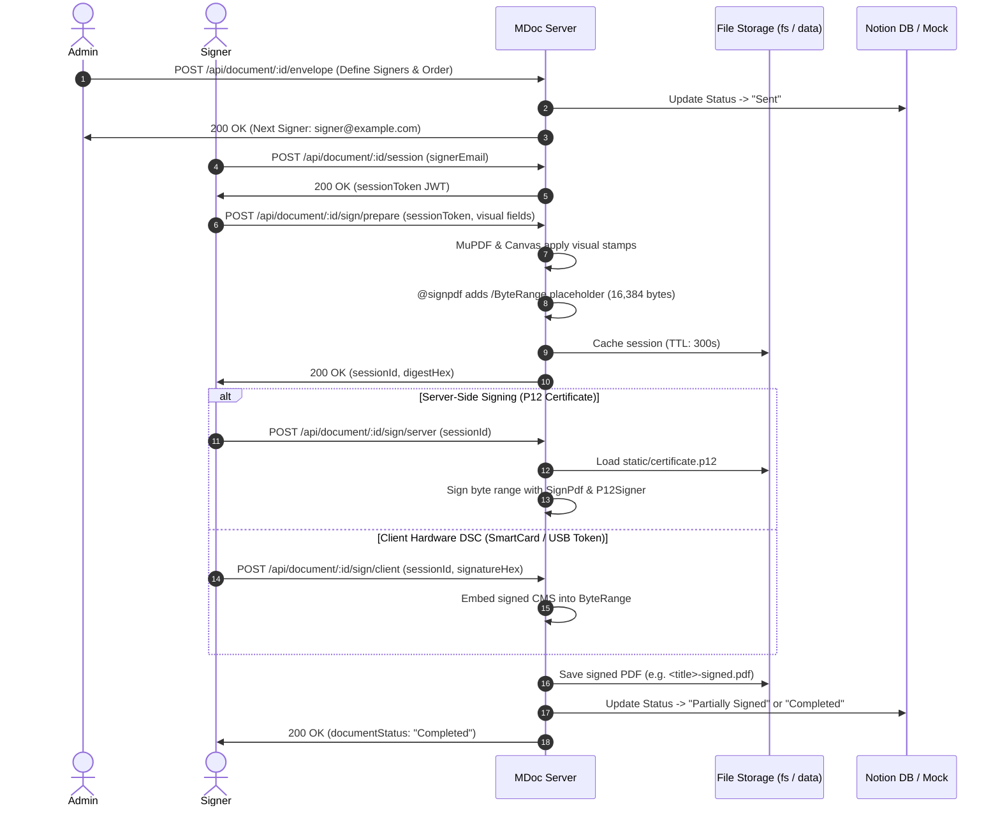

<div align="center">

# MDoc

> A high-performance, structured document generation and cryptographic signing service built on Nitro and Vue.

[](https://opensource.org/licenses/MIT)
[](https://bun.sh)
[](https://nitro.unjs.io)
[](https://mupdf.com)

</div>

---

## Overview

**MDoc** is a document compilation and cryptographic signing service engineered on [Nitro v3](https://nitro.unjs.io) and [Vue 3](https://vuejs.org). It translates structured business data into cryptographically sealed, court-admissible PDF deliverables—including invoices, quotations, certificates, and multi-party service contracts.

Unlike headless browser-based PDF generators that require heavy memory allocations and produce unpredictable pagination, MDoc uses declarative, native PDF layout compilation (`@ceereals/vue-pdf`) combined with exact visual stamp positioning (MuPDF, `@napi-rs/canvas`) and raw byte-level cryptographic signature injection (`@signpdf/signpdf`, `pkijs`).

### Features

- ⚡ **Declarative Native PDF Layout**: Compiles Vue 3 templates directly to vector PDF primitives with accurate page wrapping, avoiding headless Chromium overhead.
- 🔏 **Dual Signing Architecture**: Supports client-side hardware DSC (USB tokens / SmartCards / WebCrypto) with Adobe Acrobat-compatible CMS/PKCS#7 byte-range padding, as well as automated server-side PKCS#12 (`.p12`) signing.
- 📐 **Visual Stamp Positioning**: Places signature stamps, initials, dates, and dynamic checkboxes at precise points and coordinates across pages using MuPDF and `@napi-rs/canvas`.
- 🔄 **Sequential & Parallel Envelopes**: Multi-party routing state machine tracking status transitions (`Draft` &rarr; `Sent` &rarr; `Partially Signed` &rarr; `Completed`), next-signer assignment, and watermark invalidation (`Void`).
- 🎨 **Dynamic Theming & On-Demand Typography**: Automatic organization branding resolution, Google Fonts fetching and caching via `unifont`, and sanitised SVG/raster decor picker.
- 🤖 **Agent-Ready MCP Integration**: Built-in Model Context Protocol endpoint (`/mcp`) via `nitro-mcp-toolkit` for autonomous AI agents to inspect health and node status.

---

## Nitro CLI Tasks & Automation

MDoc defines Nitro tasks under `server/tasks/` for asset generation, font pre-warming, and maintenance.

> [!NOTE]
> Nitro tasks require the development server (`bun run dev`) to be running in another terminal.

```bash
# Generate static sample page images for template picker (public/templates/<id>/sample-<n>.png)
bun x nitro task run templates:sample-images

# CI verification: fails with non-zero exit code if template images are stale
bun x nitro task run templates:sample-images --payload '{"check":true}'

# Pre-fetch and cache Google Fonts declared by templates
bun x nitro task run fonts:warm

# Pre-fetch additional brand fonts
bun x nitro task run fonts:warm --payload '{"families":["Inter","Poppins"]}'

# Generate missing PNG thumbnails for stored PDFs
bun x nitro task run backfill-thumbnails

# Force re-generation of all thumbnails
bun x nitro task run backfill-thumbnails --payload '{"force":true}'
```

### Task Options Reference

| Task Name                 | Payload Option    | Type       | Default | Description                                                                                                                                                                    |
| :------------------------ | :---------------- | :--------- | :------ | :----------------------------------------------------------------------------------------------------------------------------------------------------------------------------- |
| `templates:sample-images` | `check`           | `boolean`  | `false` | When `true`, validates existing manifest and images against current template definitions without writing files. Exits non-zero on mismatch.                                    |
| `fonts:warm`              | `families`        | `string[]` | `[]`    | Extra font families to resolve via Google Fonts and cache into `.data/fonts/` alongside template fonts.                                                                        |
| `documents:migrate`       | `dryRun`, `force` | `boolean`  | `false` | Copies generated `.pdf`/`.png` files from the local `static/` folder to the document storage (R2/S3). Idempotent; skips keys that already exist unless `force`. Never deletes. |
| `backfill-thumbnails`     | `force`           | `boolean`  | `false` | When `true`, regenerates thumbnails for all `.pdf` files in the `documents` storage even if a `.png` thumbnail already exists.                                                 |

---

## REST API Reference

All API routes are exposed under `/api/**` with CORS enabled.

### Endpoints Overview

| Method      | Endpoint                                      | Description                                                             | Auth / Key Params                                           |
| :---------- | :-------------------------------------------- | :---------------------------------------------------------------------- | :---------------------------------------------------------- |
| `GET`       | `/api/health`                                 | Node status, app version, and build timestamp.                          | Public                                                      |
| `GET`       | `/api/document/template`                      | List registered templates with category, description, and sample URLs.  | Public                                                      |
| `GET`       | `/api/document/template/:id`                  | Template JSON Schema, field hints, and signer requirements.             | `:id` (Template ID)                                         |
| `GET`       | `/api/document/template/:id/sample.pdf`       | Sample PDF stream with placeholder tokens (`?variant=sample\|branded`). | `:id`, `variant` (default: `sample`)                        |
| `GET`       | `/api/document/template/:id/sample/:page.png` | Pre-rendered template page PNG for preview galleries.                   | `:id`, `:page`, `v` (cache hash)                            |
| `POST`      | `/api/document/template/preview`              | Live PDF rendering (`{ pdfBase64, pageCount, warnings }`).              | `?draft=true`, body: `{ templateId, variant, variables }`   |
| `POST`      | `/api/document/template`                      | Generate PDF, create thumbnail, and persist draft record in Notion.     | Body: `{ name, templateId, contactId, userId, data }`       |
| `GET`       | `/api/document/numbering/next`                | Peek next document serial number (`{OrgCode}-{Type}-{YY}-{Seq}`).       | `templateId` (req), `organizationId`, `organizationName`    |
| `GET`       | `/api/document`                               | Filtered, paginated list of documents.                                  | Query: `limit`, `offset`, `templateId`, `status`            |
| `GET`       | `/api/document/:id`                           | Fetch document record, status, relations, and stored `rawData`.         | `:id` (Notion Page ID)                                      |
| `PATCH`     | `/api/document/:id`                           | Update document metadata (`name`, `status`).                            | `:id`, body: `{ name?, status? }`                           |
| `GET`       | `/api/document/:id/content`                   | Serve PDF file or thumbnail PNG (`?type=image`, `?download`).           | `:id`, query: `type`, `download`                            |
| `POST`      | `/api/document/:id/envelope`                  | Configure signer queue and initiate envelope (`Sent` status).           | `:id`, body: `{ routingType, signers }`                     |
| `POST`      | `/api/document/:id/session`                   | Generate JWT signer session token for magic-link signing.               | `:id`, body: `{ signerEmail, expiresIn? }`                  |
| `POST`      | `/api/document/:id/session/verify`            | Verify active signer session token.                                     | `:id`, body: `{ sessionToken }`                             |
| `POST`      | `/api/document/:id/sign/prepare`              | Apply visual stamps and inject `/ByteRange` placeholder for signing.    | `:id`, body: `{ sessionToken, fields, certificateDerHex? }` |
| `POST`      | `/api/document/:id/sign/client`               | Inject hardware DSC signature (USB token / SmartCard / WebCrypto).      | Body: `{ sessionId, signatureHex }`                         |
| `POST`      | `/api/document/:id/sign/server`               | Apply automated server-side digital signature (`certificate.p12`).      | Body: `{ sessionId }`                                       |
| `POST`      | `/api/document/:id/sign/verify`               | Cryptographically verify digital signature integrity via PKCS#7 / CMS.  | `multipart/form-data` with `pdf` file                       |
| `POST`      | `/api/document/:id/void`                      | Invalidate document with a diagonal VOID watermark across all pages.    | `:id`, body: `{ reason }` (&ge; 5 characters)               |
| `GET`       | `/api/decor`                                  | List built-in SVG/raster decor assets (`?slot=`).                       | Query: `slot` (e.g. `panel-corner`)                         |
| `GET`       | `/api/decor/builtin/:file.png`                | Serve built-in decor thumbnail.                                         | `:file` (e.g. `leaf.png`)                                   |
| `POST`      | `/api/decor/upload`                           | Upload custom decor asset (PNG, JPG, WebP, SVG &le; 2 MB).              | `multipart/form-data` with `file`                           |
| `GET`       | `/api/decor/upload/:file.png`                 | Serve uploaded content-addressed decor asset.                           | `:file` (e.g. `<sha1>.png`)                                 |
| `GET`       | `/api/fonts`                                  | Search Google Fonts catalog available for on-demand resolution.         | Query: `q`, `limit` (max 50, default 20)                    |
| `GET\|POST` | `/mcp`                                        | Model Context Protocol endpoint for autonomous agent tooling.           | MCP Protocol                                                |

---

## Integration Guide & Code Examples

### 1. Unified Error Contract

Validation errors return HTTP `400 Bad Request` with an exact path to the offending field:

```json
{
  "statusCode": 400,
  "statusMessage": "Bad Request",
  "data": {
    "errors": [
      {
        "field": "recipient.email",
        "message": "Invalid recipient email",
        "code": "invalid_format"
      }
    ]
  }
}
```

> [!NOTE]
> Stack traces and local file system paths are completely stripped from error payloads across both development and production environments.

### 2. Live Preview with Draft Tolerances

When rendering live previews during user input, call `POST /api/document/template/preview?draft=true`. Missing or temporarily invalid values will fall back to placeholders and emit `warnings` rather than throwing HTTP 400:

```typescript
// Live Preview Request (TypeScript / Fetch)
const response = await fetch('http://localhost:3000/api/document/template/preview?draft=true', {
  method: 'POST',
  headers: { 'Content-Type': 'application/json' },
  body: JSON.stringify({
    templateId: 'invoice',
    variant: 'filled',
    variables: {
      organizationId: 'modest-human-brands', // Resolves preset branding & logo
      recipient: {
        name: 'Wayne Enterprises',
        email: 'billing@wayne.ent',
        address: '1007 Mountain Drive, Gotham',
        phone: '+1 555-0199',
      },
      project: {
        title: 'Brand Refresh & UI System',
        invoiceNumber: 'MHB-I-26-001',
        invoiceDate: '2026-10-15',
        quoteNumber: 'MHB-Q-26-001',
        quoteDate: '2026-10-01',
        shootLocation: 'Remote',
        shootDate: '2026-10-10',
        deliverables: [
          { title: 'Brand Guidelines', quantity: 1, rate: 5000 },
          { title: 'Design System Tokens', quantity: 1, rate: 8500 },
        ],
      },
      dueDate: '2026-10-31',
    },
  }),
})

const { pdfBase64, pageCount, warnings } = await response.json()
console.log(`Rendered ${pageCount} pages. Warnings:`, warnings ?? 'none')
```

#### Preview Variants

| Variant   | Organization Scope                               | Data Fields                         | Typical Wizard Stage           |
| :-------- | :----------------------------------------------- | :---------------------------------- | :----------------------------- |
| `sample`  | Neutral placeholder ("Your Company", gray logo)  | Shows `{{Field Label}}` tokens      | Template gallery cards         |
| `branded` | Organization branding applied (`organizationId`) | Shows `{{Field Label}}` tokens      | Brand selection step           |
| `filled`  | Organization branding applied                    | User variables merged over defaults | Form completion / final review |

**Organization.** `organizationId` selects a built-in preset with all of its fields. An `organization` object is used exactly as sent and is never merged over a preset: fields you leave out stay empty and their lines are not printed. Only the brand colours and font fall back to defaults. `name` and `contactEmail` are required (a missing one is a 400 on create and a warning in previews). Previews also return `warnings` with code `missing_recommended` for fields a template prints that are empty (`address`, and `accountDetails` for invoices and quotations).

---

### 3. Creating & Persisting a Document

Calling `POST /api/document/template` compiles the PDF, creates a PNG thumbnail, and writes a record to Notion:

```typescript
const response = await fetch('http://localhost:3000/api/document/template', {
  method: 'POST',
  headers: { 'Content-Type': 'application/json' },
  body: JSON.stringify({
    name: 'MHB-I-26-001',
    templateId: 'invoice',
    contactId: 'contact-page-id', // Notion Contact relation ID
    userId: 'user-page-id', // Notion User relation ID
    organizationId: 'modest-human-brands',
    data: {
      recipient: {
        name: 'Wayne Enterprises',
        email: 'billing@wayne.ent',
        address: '1007 Mountain Drive, Gotham',
        phone: '+1 555-0199',
      },
      project: {
        title: 'Brand Refresh',
        invoiceNumber: 'MHB-I-26-001',
        invoiceDate: '2026-10-15',
        quoteNumber: 'MHB-Q-26-001',
        quoteDate: '2026-10-01',
        shootLocation: 'Remote',
        shootDate: '2026-10-10',
        deliverables: [{ title: 'Brand Strategy', quantity: 1, rate: 5000 }],
      },
      dueDate: '2026-10-31',
    },
  }),
})

const result = await response.json()
// Returns: { id: "notion-id", templateId: "invoice", name: "MHB-I-26-001", sizeBytes: 160578 }
```

---

### 4. End-to-End Cryptographic Signing Pipeline

The signing pipeline supports both automated corporate seals and interactive client hardware tokens:



#### Step A: Initiate Envelope

```bash
curl -X POST http://localhost:3000/api/document/DOC_ID/envelope \
  -H "Content-Type: application/json" \
  -d '{
    "routingType": "SEQUENTIAL",
    "signers": [
      { "order": 1, "name": "Jane Doe", "email": "signer@example.com", "role": "Contractor" },
      { "order": 2, "name": "Corporate Officer", "email": "officer@example.com", "role": "Company" }
    ]
  }'
```

#### Step B: Create Session Token

```bash
curl -X POST http://localhost:3000/api/document/DOC_ID/session \
  -H "Content-Type: application/json" \
  -d '{ "signerEmail": "signer@example.com" }'
```

#### Step C: Prepare Visual Stamps & Byte Range

```bash
curl -X POST http://localhost:3000/api/document/DOC_ID/sign/prepare \
  -H "Content-Type: application/json" \
  -d '{
    "sessionToken": "JWT_TOKEN_HERE",
    "fields": {
      "contractor-signature": "data:image/png;base64,iVBORw0KGgo...",
      "contractor-city": "Mumbai"
    }
  }'
# Returns: { "sessionId": "UUID", "digestHex": "...", "signerEmail": "signer@example.com" }
```

#### Step D: Execute Signature

```bash
# Option 1: Automated Server Seal (.p12)
curl -X POST http://localhost:3000/api/document/DOC_ID/sign/server \
  -H "Content-Type: application/json" \
  -d '{ "sessionId": "UUID_FROM_PREPARE" }'

# Option 2: Client Hardware Signature
curl -X POST http://localhost:3000/api/document/DOC_ID/sign/client \
  -H "Content-Type: application/json" \
  -d '{ "sessionId": "UUID_FROM_PREPARE", "signatureHex": "CMS_SIGNATURE_HEX" }'
```

#### Step E: Verify Cryptographic Integrity

```bash
curl -X POST http://localhost:3000/api/document/DOC_ID/sign/verify \
  -F "pdf=@signed-document.pdf"
# Returns: { "isIntact": true, "signer": "Modest Human Brands LLP", "message": "Document is intact and signature is valid." }
```

---

## Template Catalog

The server registers 5 production document templates:

| Template ID                         | Label                             | Category     | Default Pages | Signers | Fonts Used                         |
| :---------------------------------- | :-------------------------------- | :----------- | :-----------: | :-----: | :--------------------------------- |
| `invoice`                           | Billing Invoice                   | Billing      |       1       |    0    | `Exo2`, `Oxanium`                  |
| `quotation`                         | Quotation                         | Billing      |       6       |    2    | `Exo2`, `Oxanium`                  |
| `internship-completion-certificate` | Internship Completion Certificate | Certificates |       1       |    1    | `Exo2`, `IslandMoments`, `Oxanium` |
| `retainer-contract`                 | Retainer Contract                 | Contracts    |       4       |    2    | `Exo2`, `Oxanium`                  |
| `shoot-contract`                    | Shoot Contract                    | Contracts    |       3       |    2    | `Exo2`, `Oxanium`                  |

### JSON Schema Layout Hints

Calling `GET /api/document/template/:id` generates standard JSON Schema enriched with UI layout hints:

- **`x-section`**: Heading for grouping fields in forms/accordions.
- **`x-column`**: Suggested layout width (`1` = half-width, `2` = full-width).
- **`x-order`**: 1-based sequential sort index for input rendering.
- **`x-auto`**: Field is server-calculated (`invoiceNumber`, `quoteNumber`). Render as read-only and prefill via `/api/document/numbering/next`.
- **`x-boilerplate`**: Long-form legal or Markdown terms content.

---

## Local Development & Operations

<details>
<summary><strong>Environment Configuration, Build Scripts & Docker</strong></summary>

### Prerequisites

- **Bun** `>= 1.2.9` (recommended) or **Node.js** `>= 22.12.0`
- Native module compilation tools (required for `mupdf` and `@napi-rs/canvas`):
  - **Linux (Ubuntu/Debian)**: `sudo apt-get install -y build-essential python3 pkg-config libpixman-1-dev libcairo2-dev libpango1.0-dev`
  - **macOS**: `xcode-select --install`
  - **Windows**: Visual Studio C++ Build Tools

### Environment Variables

| Variable                                   | Type     | Default                      | Description                                                                                                                   |
| :----------------------------------------- | :------- | :--------------------------- | :---------------------------------------------------------------------------------------------------------------------------- |
| `NODE_ENV`                                 | `string` | `development`                | Set to `development` for offline file-backed Notion mock (`.data/notion-mock.json`). Set to `production` for live Notion API. |
| `PORT`                                     | `number` | `3000`                       | Port for the HTTP server.                                                                                                     |
| `NITRO_PRESET`                             | `string` | `node-server`                | Nitro deployment target (e.g. `node-server`, `bun`).                                                                          |
| `NITRO_APP_VERSION`                        | `string` | `package.json version`       | Application version emitted by `/api/health`.                                                                                 |
| `NITRO_APP_BUILD_TIME`                     | `string` | `Build timestamp`            | Build time string emitted by `/api/health`.                                                                                   |
| `NITRO_PUBLIC_DOC_URL`                     | `string` | `http://localhost:3000`      | Base public URL of the service used when constructing preview URLs.                                                           |
| `NITRO_PRIVATE_NOTION_DB_ID`               | `string` | `{"document":"mock-doc-db"}` | JSON string containing Notion Database IDs: `{"document":"<db-id>"}`.                                                         |
| `NITRO_PRIVATE_JWT_SECRET`                 | `string` | (required)                   | Secret key for signing and verifying magic-link session tokens.                                                               |
| `NITRO_PRIVATE_CERTIFICATE_SECRET`         | `string` | (required for .p12)          | Passphrase for unlocking `static/certificate.p12`.                                                                            |
| `NITRO_PRIVATE_DOCUMENT_BUCKET`            | `string` | (required in production)     | Bucket for generated documents (Cloudflare R2 or any S3-compatible service).                                                  |
| `NITRO_PRIVATE_DOCUMENT_ENDPOINT`          | `string` | (required with bucket)       | S3 endpoint, e.g. `https://<account>.r2.cloudflarestorage.com` or `https://s3.<region>.amazonaws.com`.                        |
| `NITRO_PRIVATE_DOCUMENT_REGION`            | `string` | `auto`                       | Bucket region (`auto` for R2).                                                                                                |
| `NITRO_PRIVATE_DOCUMENT_ACCESS_KEY_ID`     | `string` | (required with bucket)       | Access key ID with read/write access to the bucket.                                                                           |
| `NITRO_PRIVATE_DOCUMENT_SECRET_ACCESS_KEY` | `string` | (required with bucket)       | Secret access key.                                                                                                            |
| `NOTION_API_KEY`                           | `string` | (optional in dev)            | Notion integration secret key (required when `NODE_ENV=production`).                                                          |

### Storage Mounts

The service relies on two storage layers defined in `nitro.config.ts`:

- **`documents` storage**: Generated `.pdf` documents and `.png` thumbnails. In production it is an S3-compatible bucket (Cloudflare R2, AWS S3) configured through `NITRO_PRIVATE_DOCUMENT_*` and mounted by `server/plugins/storage.ts`; startup fails if it is not configured. In development without those variables it falls back to `.data/documents/`. Move existing files with `bun run documents:migrate`.
- **`static/` (`fs` storage)**: Only the server signing certificate (`certificate.p12`). It is deliberately kept out of the bucket.
- **`.data/` (`data` storage)**: Stores the font cache (`.data/fonts/`), uploaded decor assets (`.data/decor-uploads/`), signing sessions (`.data/sign/`), and the local database mock (`.data/notion-mock.json`).

### Package Scripts

| Script                 | Command                                              | Description                                                                 |
| :--------------------- | :--------------------------------------------------- | :-------------------------------------------------------------------------- |
| `bun run dev`          | `nitro dev`                                          | Starts local development server with hot-reload at `http://localhost:3000`. |
| `bun run build`        | `nitro build`                                        | Compiles server output to `.output/server/index.mjs`.                       |
| `bun run start`        | `node --env-file=.env.prod .output/server/index.mjs` | Starts built production server using Node.js runtime.                       |
| `bun run preview`      | `nitro preview`                                      | Previews production build locally.                                          |
| `bun run lint`         | `eslint . --fix`                                     | Runs ESLint over project code.                                              |
| `bun run format`       | `prettier . --write`                                 | Formats codebase with Prettier.                                             |
| `bun run test:load`    | `k6 run tests/load.test.ts`                          | Runs k6 load tests against endpoints.                                       |
| `bun run clean`        | `nitro cleanup`                                      | Cleans up Nitro build artifacts.                                            |
| `bun run docker:build` | `docker build ...`                                   | Builds container image `mdoc:dev`.                                          |
| `bun run docker:start` | `docker run ...`                                     | Runs containerized server on port `3500`.                                   |

### Docker Deployment

Build and run using the optimized multi-stage `Dockerfile`:

```bash
# Build production Docker image
docker build --build-arg VERSION=0.3.12 --build-arg BUILD_TIME=$(date -u +'%Y-%m-%dT%H:%M:%SZ') -t mdoc:latest .

# Run container with persistent storage volumes
docker run -d \
  --name mdoc \
  -p 3000:3000 \
  -e NODE_ENV=production \
  -e NITRO_PUBLIC_DOC_URL=https://doc.example.com \
  -e NITRO_PRIVATE_JWT_SECRET="your-jwt-secret" \
  -e NITRO_PRIVATE_CERTIFICATE_SECRET="your-p12-secret" \
  -e NOTION_API_KEY="secret_..." \
  -e NITRO_PRIVATE_NOTION_DB_ID='{"document":"your-notion-db-id"}' \
  -v $(pwd)/static:/app/static \
  -v $(pwd)/.data:/app/.data \
  mdoc:latest
```

</details>

---

## License

Published under the [MIT License](https://github.com/Modest-Human-Brands/mdoc/blob/main/LICENSE).

<br>

<a href="https://github.com/Modest-Human-Brands/mdoc/graphs/contributors">
  
</a>
